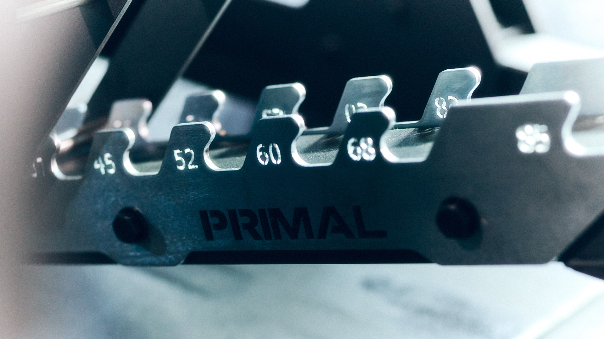

# Primal Strength US - Shopify Theme Customizations

**Live Store:** [us.primalstrength.com](https://us.primalstrength.com)

This repository contains the custom Liquid snippets, JavaScript assets, and email templates developed for the Primal Strength US Shopify storefront (`us.primalstrength.com`). These modifications resolve critical storefront bugs, protect quote-only commerce flows, support reusable product templates, adapt UK-specific features for the US market, and integrate third-party financing solutions.

**Maintainer:** Nicolas Cartin Reyes, Lead Dev

## Current Production Highlights

| Area | Current result | Scope |
|---|---|---|
| **ADA / WCAG 2.2 AA** | 0 automated WCAG 2.2 AA violations on 9 key routes (desktop and mobile), plus an accessibility options launcher. | 11 theme files; see [technical record](docs/TECHNICAL-ADA-WCAG22.md) |
| **GSA government purchasing** | Dedicated public page with configurable contract details, purchase steps, contact actions, disclaimer, and responsive layout. | `sections/gsa-government-purchasing.liquid`, `templates/page.gsa.json`, and `/pages/gsa` |
| **Dynamic Product Video** | Products can show either a Shopify-hosted video or a YouTube/Vimeo URL. The block is hidden when no valid media is assigned. | Default product and Quote templates; live theme `142304510051` and development theme `160888946787` |
| **Quote-only commerce protection** | Quote products retain **Request a Quote** while hidden purchase forms and unintended cart paths are removed. Quote-template products were removed from Point of Sale so they cannot be sold through that channel accidentally. | `snippets/buy-button.liquid`, `snippets/quote-bulk-order.liquid`, and Shopify channel configuration |
| **Collection merchandising priority** | In-stock products using the Default product template were promoted to the top of every collection. Automatic collection sorting was converted to manual ordering so the merchandising priority remains deterministic. | Shopify collection configuration and product ordering; no unrelated theme code |
| **Inventory and Add to Cart reliability** | Corrected availability checks for the USA distribution location, product forms, and collection Sold Out badges. | Liquid, JavaScript, and inventory-location configuration |
| **Financing integrations** | ChargeAfter and Finance Partners work is documented for the US storefront, with financing code kept separate from product and quote flows. | Financing snippets and documented global integration procedures |
| **Brand navigation** | The combined Echelon and PRIMAL logo remains visually unchanged while each brand region is independently clickable and keyboard accessible. | `sections/header.liquid` |

The repository tracks theme source and technical documentation. Store-level Admin changes, such as channel publication and collection ordering, are identified separately so they are not mistaken for theme-code changes.

**Latest release:** [ADA / WCAG 2.2 AA remediation](docs/TECHNICAL-ADA-WCAG22.md)
**Latest documentation update: November 23, 2026 local / November 24 UTC:** [Premier and Cardio status and technical handoff](docs/workstreams/2026-11-19-primal-premier/STATUS_AND_HANDOFF_2026-11-23.md), by Nicolas Cartin Reyes, Lead Dev. Last technical verification was November 20; this documentation-only update includes no fresh store tests or deployment.

**Last-verified Premier configuration:** [Official Echelon pricing and Stride-8s shipping addendum](docs/workstreams/2026-11-19-primal-premier/Primal_Official_Echelon_Pricing_and_Stride8_Shipping_2026-11-20.md). USD sale / compare-at / included savings: Stride-8s **\$2,195.99 / \$2,999.99 / \$804**, EX-5s-22 BLACK **\$999.99 / \$1,699.99 / \$700**, Row-s **\$799.99 / \$1,799.99 / \$1,000**. Official Echelon comparisons supersede temporary sheet values. EX-Pro **\$4,599.99** and Stride-9s Pro **\$6,399.99** commercial confirmation is resolved, compare-at null, no Black Friday labels. Five equipment products and three plans were ACTIVE/listed, real purchases enabled, required pairing and failure blocking preserved; all eight excluded from extra Primal 10%/15% tiers and threshold subtotal.

**Release and acceptance boundary:** Nine approved theme files on LIVE `142304510051` matched DEV `189874339939`; 110 offline and 31 offer checks passed. Backend `primal-stride8-any-plan-shipping-20261120` was ACTIVE, released November 20 at 21:09:51 UTC; reviewed rollback is `primal-premier-live-20261119`. Stride-8s supports included contiguous-US shipping with any valid required plan, with Monthly restricted to all-Stride delivery groups. The native 390 × 844 Monthly cart passed HTTP 200, equipment \$2,195.99/first month \$0, one immediate checkout CTA and no overflow. Checkout click timed out; no fresh shipping rates were observed. All-three-plan paid-rate checkout, other Monthly and Primal-only/mixed-tier controls remain pending. Paid purchase, recurring billing and provisioning remain untested. See the [workstream](docs/workstreams/2026-11-19-primal-premier/README.md), [SOP v1.3](docs/workstreams/2026-11-19-primal-premier/SOP_Premier_Cardio_Cart_Release.md) and [shipping boundaries](docs/workstreams/2026-11-19-primal-premier/SHIPPING_POLICY_2026-11-20.md); historical records remain dated evidence, not fresh acceptance.

---

## Key Fixes and Features

### 1. Storefront Availability and Add-to-Cart Fix

Resolved an issue where products were incorrectly displaying as "Sold Out" and preventing users from adding items to the cart, despite having inventory available in the US distribution center.

**Root Cause:** The US inventory location was not enabled for online order fulfillment in Shopify Settings. Once the location was enabled, the following code fixes ensured the storefront accurately reflected product availability.

**Files modified:**

| File | Change |
|------|--------|
| `snippets/buy-button.liquid` | Removed hardcoded `disabled` and "Out of stock" conditions so the button consistently renders "Add to Cart" |
| `assets/gaia-product-form.min.js` | Updated JavaScript validation to check `inventory_policy !== "continue"`, preventing the script from blocking the add-to-cart action |
| `snippets/card-badges.liquid` | Fixed a broken Liquid condition (``) and restored the dynamic `` logic so the "Sold Out" badge only appears when a product is genuinely unavailable |

---

### 2. ChargeAfter Financing Integration

ChargeAfter provides consumer and home-use financing. Ascentium remains the approved commercial financing tool. The approved ChargeAfter PDP changes are saved in unpublished theme `189336289379`: financing below the short description and above Payment options, with the split-payment app's existing controls preserved.

**Current source and references:**

| File | Description |
|------|-------------|
| `snippets/finance.liquid` | Existing promotional markup, SKU, price and eligibility, plus the positioning-helper include |
| `assets/chargeafter-pdp-position.js` | Repositions the existing split-payment control after financing without replacing its event handlers |
| `examples/chargeafter/product-block-order.patch` | Minimal default-template ordering change; unrelated product content is not duplicated |
| `assets/primal-financing-black.svg` and `assets/primal-financing-black-transparent.png` | Approved all-black, transparent provider branding |

**Status:** Sandbox display and desktop/mobile positioning were verified. No application, order or payment was submitted. Production credentials and activation remain pending; these changes have not been published to the live theme. Theme previews do not isolate Shopify's store-wide payment-provider settings.

The historical UK-to-US financing refactor remains separate from this update. See the [technical implementation and validation record](docs/TECHNICAL-CHARGEAFTER-CONSUMER-FINANCING.md) for source scope, branding and production prerequisites.

---

### 3. Dynamic Product Video Metafields

Added a reusable Product Video block to the Default product and Quote templates in the development and live themes. Each product can now use either a Shopify-hosted video upload or a YouTube/Vimeo URL without creating a product-specific template or hardcoded product condition.

The implementation uses these product metafields:

| Admin label | Namespace and key | Type |
|------|------|------|
| PDP Product Video | `custom.pdp_product_video` | `file_reference`, video files only |
| PDP Product Video Embed URL | `custom.pdp_product_video_embed` | `url` |

The uploaded Shopify-hosted video takes priority. When neither field contains valid media, the block is omitted completely. The implementation is deployed to development theme `160888946787` and live theme `142304510051` for both supported product templates. New product videos are assigned by saving the relevant product metafield; they do not require a theme deployment.

**Documentation:**

- [Technical architecture](docs/TECHNICAL-PRODUCT-VIDEO-METAFIELDS.md)
- [Product setup SOP](docs/SOP-PRODUCT-VIDEO-METAFIELDS.md)
- [Development, QA, and release SOP](docs/SOP-PRODUCT-VIDEO-QA-RELEASE.md)
- [Liquid renderer reference](snippets/product-video.liquid)

---

### 4. Split Echelon and PRIMAL Logo Links

The Primal header uses one combined inline SVG containing the Echelon and PRIMAL wordmarks. The implementation preserves that visual mark and adds two accessible anchor regions so each brand can be selected independently. The Echelon region opens `https://echelonfit.com/`, while the PRIMAL region remains on the Primal Strength US homepage through Shopify's `routes.root_url`.

The implementation is limited to `sections/header.liquid`. It branches only when `section.settings.logo_svg` is populated, keeps the existing image and text fallback behavior unchanged, and does not use JavaScript for navigation. The `49.7%` and `50.3%` regions are based on the current SVG divider geometry. The CSS includes explicit pointer-event and positioning protections for the theme's transparent-header behavior.

**Documentation:**

- [Technical architecture](docs/TECHNICAL-SPLIT-ECHELON-PRIMAL-LOGO-LINKS.md)
- [Deployment and rollback SOP](docs/SOP-SPLIT-ECHELON-PRIMAL-LOGO-LINKS.md)
- [PDF SOP reference](docs/SOP-SPLIT-ECHELON-PRIMAL-LOGO-LINKS.pdf)
- [Complete `header.liquid` source](sections/header.liquid)

---

### 5. GSA Government Purchasing Landing Page
Implemented a dedicated government purchasing page at [`/pages/gsa`](https://us.primalstrength.com/pages/gsa) using the `gsa` page template. The page record has an empty body and the template renders all content through a dedicated Liquid section.

**Files added:**

| File | Description |
|---|---|
| `sections/gsa-government-purchasing.liquid` | Configurable GSA layout with contract details, purchase steps, contact actions, responsive styling, and accessible external-link behavior. |
| `templates/page.gsa.json` | Section instance, ordered purchase steps, external contract URL, and contact configuration. |

The production deployment was intentionally scoped to those two theme files with `--only`, `--nodelete`, and `--allow-live`. The published page uses handle `gsa`, template suffix `gsa`, and no navigation link. Desktop and mobile QA confirmed the contract link, mailto and telephone actions, two-column desktop layout, and single-column mobile layout.

**Documentation:**

- [Technical architecture and deployment guide](docs/TECHNICAL-GSA-GOVERNMENT-PURCHASING.md)
- [GSA section source](sections/gsa-government-purchasing.liquid)
- [GSA page template](templates/page.gsa.json)

---

### 6. ADA / WCAG 2.2 AA Remediation

Fixed every automated WCAG 2.2 AA failure on the key storefront routes and added an accessibility options launcher (text size, high contrast, underline links, readable font, reduce motion). Fixes cover the HappyFox chat iframe title, nested interactive elements in the video poster and Contact FAQ, the collection sort dropdown roles, compare-at price contrast, and 24px touch targets for gallery dots and Contact links.

Released to live on October 29, 2026 with a scoped push of 11 files, after a full backup theme. Live QA with axe-core 4.10.3 returned 0 violations on 18 of 18 route and viewport checks. The [accessibility statement page](https://us.primalstrength.com/pages/accessibility-statement) went live the same day. Its `Accessibility` footer link is live under Legal, immediately after CCPA Privacy Policy.

In `layout/theme.liquid`, third-party identifiers are replaced with placeholders in this repository.

**Documentation:**

- [Technical record, checksums and rollback](docs/TECHNICAL-ADA-WCAG22.md)
- [Live deployment QA report (PDF)](docs/QA-ADA-WCAG22-LIVE-DEPLOYMENT.pdf)

---

### 7. Order Confirmation Email Template

Adapted the default Shopify order confirmation email to reflect Primal Strength US shipping policies and contact information.

**File modified:** `templates/order-confirmation-email.html`

Changes include:
- Updated dispatch time to 2–3 business days
- Added carrier-specific delivery expectations: FedEx Ground (5–7 business days) for orders under 150 lbs, and FedEx Freight (10–14 business days) for orders over 150 lbs
- Updated customer service contact to `cs@echelonfit.com` and the Echelon support portal (`support.echelonfit.com/new`)

---

## Repository Structure

```
├── assets/
│   ├── accessibility-launcher.js      # Accessibility panel, HappyFox iframe title
│   ├── component-image-with-text.css  # ADA fixes (video poster, contact targets)
│   ├── gaia-product-form.min.js       # JavaScript form validation fix
│   ├── global.css                     # ADA: gallery dot target size
│   └── main-product.css               # ADA: compare-at price contrast
├── layout/
│   └── theme.liquid                   # Launcher render (third-party IDs redacted)
├── sections/
│   ├── faq.liquid                     # ADA: native details/summary FAQ
│   ├── main-accessibility-statement.liquid # Accessibility statement page section
│   ├── gsa-government-purchasing.liquid # GSA purchasing page section
│   ├── image-with-text-new.liquid     # ADA: video poster button
│   └── header.liquid                  # Split Echelon and PRIMAL logo links
├── snippets/
│   ├── accessibility-launcher.liquid  # Accessibility options launcher
│   ├── buy-button.liquid              # Add to Cart button logic
│   ├── card-badges.liquid             # Dynamic Sold Out badge
│   ├── charge-after-widget.liquid     # ChargeAfter SDK initialization
│   ├── component-faq.liquid           # ADA: unique FAQ ids
│   ├── facets.liquid                  # ADA: sort dropdown roles
│   ├── financing-widget.liquid        # PDP promotional financing widget
│   ├── pagination.liquid              # Included in the ADA release
│   └── product-video.liquid           # Dynamic hosted or YouTube/Vimeo product video
├── templates/
│   ├── page.accessibility-statement.json # Accessibility statement template
│   ├── order-confirmation-email.html  # Customized order confirmation email
│   └── page.gsa.json                  # GSA page template configuration
├── docs/
│   ├── TECHNICAL-ADA-WCAG22.md
│   ├── QA-ADA-WCAG22-LIVE-DEPLOYMENT.pdf
│   ├── TECHNICAL-GSA-GOVERNMENT-PURCHASING.md
│   ├── TECHNICAL-SPLIT-ECHELON-PRIMAL-LOGO-LINKS.md
│   ├── SOP-SPLIT-ECHELON-PRIMAL-LOGO-LINKS.md
│   ├── TECHNICAL-PRODUCT-VIDEO-METAFIELDS.md
│   ├── SOP-PRODUCT-VIDEO-METAFIELDS.md
│   ├── SOP-PRODUCT-VIDEO-QA-RELEASE.md
│   ├── SOP-SPLIT-ECHELON-PRIMAL-LOGO-LINKS.pdf
│   └── CHANGELOG.md
├── banner.jpg
└── README.md
```

---

## Deployment

All files in this repository correspond directly to their respective paths in the active Shopify theme (`ux-project/Live`). Files should be copied into the matching directories within the Shopify theme code editor.
