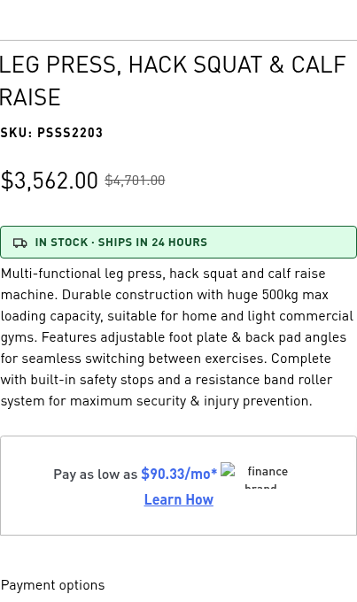

# Primal Consumer Financing: ChargeAfter

**Author:** Nicolas Cartin Reyes, Lead Developer
**Updated:** November 4, 2026
**Status:** Approved Dev implementation; production activation pending

## Integration boundary

ChargeAfter serves consumer and home-use financing. Ascentium remains the approved commercial financing tool for Primal and Echelon commercial customers. These are separate paths; this implementation does not replace the commercial financing integration.

The approved PDP layout is saved in unpublished theme `189336289379`, **Dev Primal footer fixes 10/29**. The financing line appears below the short product description and above the split-payment app's **Payment options**. This positioning work has not been deployed to live theme `142304510051`.

Sandbox offers now render in the tested preview. Production credentials remain pending confirmation, and this work did not activate the ChargeAfter checkout gateway or change any store-wide payment-provider configuration. Repository updates are implementation references, not a live deployment.

## Scoped source

| Repository file | Purpose |
|---|---|
| [`../snippets/finance.liquid`](../snippets/finance.liquid) | Existing promotional markup, SKU, price, financing-page destination and eligibility; adds only the helper include. |
| [`../assets/chargeafter-pdp-position.js`](../assets/chargeafter-pdp-position.js) | Moves the existing split-payment control after the financing wrapper without replacing controls or handlers. |
| [`../examples/chargeafter/product-block-order.patch`](../examples/chargeafter/product-block-order.patch) | Minimal patch moving `custom_finance_box_Rby47m` immediately before `buy_buttons` in `sections.main.block_order` of `templates/product.json`. |
| [`../assets/primal-financing-black.svg`](../assets/primal-financing-black.svg) | Approved, font-independent vector logo for the provider's application header. |
| [`../assets/primal-financing-black-transparent.png`](../assets/primal-financing-black-transparent.png) | Transparent raster export of the approved logo. |

The full product template is intentionally not duplicated: the patch records the approved ordering change without importing unrelated product content. Apply it only after comparing the current template with its expected context. Preserve all other block settings and relative order.

`snippets/charge-after-widget.liquid` initializes the SDK globally through the existing layout integration. The Dev SDK configuration is separate from this three-file positioning change. No public or private merchant credentials are included in this update.

## Eligibility and positioning

Eligibility remains `finance_value >= 30000`, equivalent to USD 300 or more, and `product.vendor contains 'Primal'`. Existing group/product/cart value selection, the `pdp == true` rendering condition and enclosing product-section exclusions remain unchanged. No Quote template, buy-button logic, product data or purchase-protection behavior was modified.

The helper inspects each `.product-details` container for `.finance-block .ca-promotional-widget`, its `.product-blocks-boxed` wrapper and `gaia-product-form`. It acts only when that wrapper is a direct child of the container and precedes the product form.

The split-payment app inserts `.spp2__widget_deposit` inside the short description. The helper moves that existing node immediately after the financing wrapper. A `MutationObserver` handles delayed insertion. Existing event handlers are retained, and an already-correct position is left unchanged.

The include remains inside the eligible PDP branch of `finance.liquid`, immediately after the promotional markup:

```liquid
<script src="{{ 'chargeafter-pdp-position.js' | asset_url }}" defer="defer"></script>
```

This is a layout helper, not SDK initialization or checkout payment configuration.

## Verified behavior and limits

The [Dev preview](https://us.primalstrength.com/products/leg-press-hack-squat?preview_theme_id=189336289379), SKU `PSSS2203`, showed one financing widget above Payment options at desktop `1440 × 1000` and mobile `390 × 844`. Split-payment control interaction was verified, and the scoped remote files matched the local implementation.



These checks establish tested placement, control interaction and sandbox-offer display only. They do not establish coverage across every product, variant, template or browser, financing approval, or successful checkout payment. No financing application, order or payment was submitted. The retained placement report contains both viewports; the retained controls report contains desktop results.

## Approved provider branding

The logo preserves the original PRIMAL wordmark, including its registered mark, and uses the exact FINANCING glyph paths from the Echelon provider reference. Both groups are black. The subtitle retains the reference's rounded stroke treatment. The SVG uses vector paths rather than font-dependent text, has no background rectangle, and the PNG has true alpha transparency.

| Asset | Dimensions |
|---|---|
| SVG | `877.540 × 315.337` units, matching its `viewBox` |
| Transparent PNG | `1756 × 631` pixels |


Sources: [official PRIMAL wordmark](https://www.primalstrength.com/) and [Echelon Financing vector reference](https://cdn.chargeafter.com/assets/brands/echelon/logo.svg). The approved assets were supplied to ChargeAfter for sandbox and production branding. Delivery of the assets does not establish that provider-side rollout is complete.

## Production prerequisites

Confirm the production credentials and intended environment with ChargeAfter, then repeat the approved preview checks without changing the widget position. Keep private credentials out of theme code and all credentials out of repository references.

Production SDK validation, live-theme publication and checkout gateway activation are separate steps. Theme previews isolate frontend theme changes, **not Shopify's store-wide checkout payment-provider settings**. A real application or payment test must be authorized separately and must not be represented as a sandbox test.

## Rollback

Restore the pre-change default-product block order and `finance.liquid` in the unpublished theme. Once the helper include is removed, remove the unused helper asset through the normal scoped theme workflow. Revalidate the restored layout without overwriting unrelated theme work or changing payment-provider settings.
