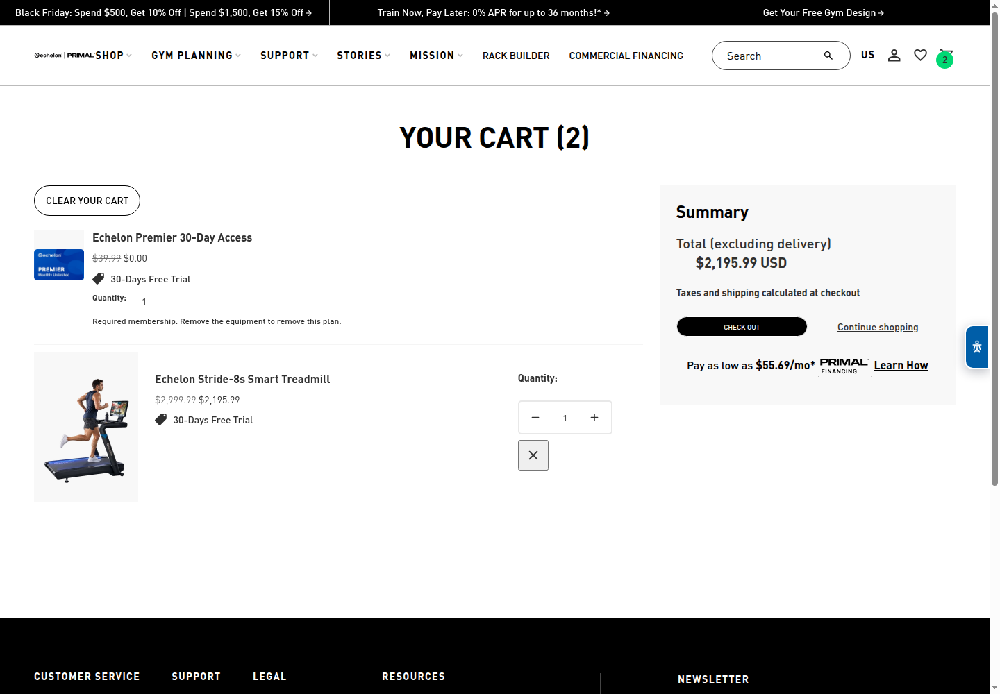
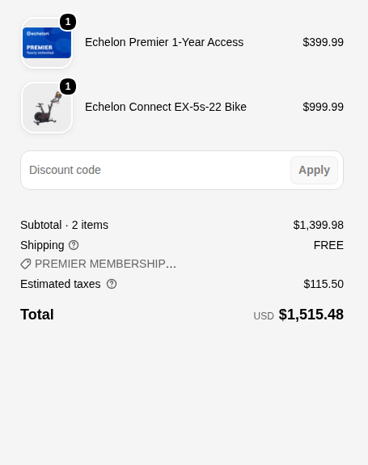

> **SUPERSEDED HISTORICAL ADDENDUM — November 20, 2026.** Keep the original body below as dated exclusion evidence, not current pricing or fresh checkout acceptance. The prior hidden collection exclusion remains LIVE unchanged: all five equipment products and three Premier plans are excluded from extra Primal 10%/15% tiers and threshold subtotal. Use the [current official-pricing and shipping addendum](Primal_Official_Echelon_Pricing_and_Stride8_Shipping_2026-11-20.md). Official Echelon authority supersedes temporary sheet values; LIVE USD sale / compare-at / savings: Stride-8s \$2,195.99 / \$2,999.99 / \$804; EX-5s-22 BLACK \$999.99 / \$1,699.99 / \$700; Row-s \$799.99 / \$1,799.99 / \$1,000. Harrison resolved commercial confirmation; EX-Pro \$4,599.99 and Stride-9s Pro \$6,399.99 have compare-at null and no Black Friday label.
>
> **Backend release:** `primal-stride8-any-plan-shipping-20261120` (LIVE; released 2026-11-20 21:09:51 UTC). Stride-8s any-plan copy is LIVE, but backend release is LIVE; fresh checkout-rate QA remains pending. Earlier 15-cart/three EX-5s-22 checkout/two annual-shipping observations below remain historical only. The latest anonymous mobile PDP returned HTTP 200; cart empty, zero checkout buttons, no shipping rates reached. Historical PDFs remain unchanged.

# Primal Black Friday: Echelon exclusion correction

**Current retail price correction, November 20:** Harrison's full USA file is the retail source. Stride-8s is $1,999.99 (compare-at $2,249.99), EX-5s-22 $999.99 (compare-at $1,299.99), and Row-s $799.99 (compare-at $1,299.99). The older Stride-8s $2,195.99 example is historical. EX-Pro and Stride-9s Pro have no verified retail BF pair in that file; no dealer pricing or invented sale label is used. Savings-message presentation is DEV only, awaiting direction on blocked mobile/cart QA. Missing public sale/compare-at prices were requested from Harrison, John and Lou. See the [current pricing correction](Primal_Black_Friday_Pricing_and_Included_Savings_2026-11-20.md).

**Date:** November 20, 2026  
**Lead developer:** Nicolas Cartin Reyes  
**Status:** Live discount correction; all 15 cardio/membership cart combinations verified.

Harrison reported that Primal's 10%/\$500 and 15%/\$1,500 Black Friday tiers were stacking on the Echelon cardio prices. Both existing tier discounts have now been restricted to non-Echelon eligible products. This correction supersedes the all-product scope described in the November 19 release and the November 20 morning recap. Those records remain dated history, not the current discount policy.

## Current purchasing behavior

The five Echelon cardio products keep their existing item prices: EX-Pro \$4,599.99, EX-5s-22 \$999.99, Stride-9s Pro \$6,399.99, Stride-8s \$2,195.99 and Row-s \$799.99. They no longer receive an additional Primal 10% or 15% tier discount. The three required Premier plans are also outside those tiers, preventing an unintended discount on the plan charge.

First Month Free remains available for one qualifying Monthly membership paired with equipment. Annual and two-year Premier free shipping remain active. Membership pairing, technical-failure blocking and real-purchase enablement were not changed. No app or theme deployment was required.

Primal's tier percentages, \$500/\$1,500 minimums, start/expiry dates and discount combinations are preserved. Only eligible product lines contribute to those thresholds and receive the tier discount. Excluded Echelon equipment and membership lines do not qualify a mixed cart for a higher tier. The Black Friday homepage product row and the separate Black Friday Specials collection remain unchanged.

## Implementation

Both existing automatic discounts now target the smart collection **Primal Black Friday Tier Eligible**, handle `primal-bf-tier-eligible`, ID `gid://shopify/Collection/514488369251`. Its AND rules are `TAG NOT_EQUALS Echelon Cardio` and `TAG NOT_EQUALS Echelon Premier`. Readback confirmed all five equipment products and all three plans are excluded; 565 other catalog records are included at this snapshot. Collection membership does not override stock, publication or quote-only safeguards. Future eligibility follows the same tags.

The 10% discount retains ID `1566285529187`; the 15% discount retains ID `1566285496419`. Selecting specific eligible products changes the native discount class from order-wide to PRODUCT. Both allow product and shipping combinations, not order combinations, and retain expiry `2026-12-01T04:59:59Z`. The other four active discount definitions were unchanged in readback. Catalog data, prices, inventory, media, quote-only rules, app Functions and live theme files were not modified.

## Verified acceptance

All 15 combinations of five equipment products and three plans passed fresh anonymous cart checks: no Primal Black Friday tier allocation, equipment price preserved, correct membership charge and two associated lines. All five Monthly carts retained the \$0 qualifying membership benefit. EX-5s-22 checkout entry was rechecked with all three plans and showed no Primal Black Friday tier.

The exact Stride-8s cart reported by Harrison now shows \$2,195.99 before tax/delivery, with the Monthly membership free, instead of an additional 15% reduction. Annual and two-year EX-5s-22 checkouts at the previously authorized public Texas test address both show Shipping FREE and the named Premier shipping discount, with no Primal Black Friday tier.

**Primal-only and mixed-cart controls:** Not completed. The first control item was sold out; subsequent automated checks were interrupted by the QA environment's Cloudflare HTTP 429 connection verification. A bounded cooldown obtained one HTTP 200 page, but the four final control navigations still timed out. Original failures and rechecks are retained, not reported as passes. The live discount configuration, 15 Echelon cart checks and two shipping observations above are established independently. Primal-only and mixed-cart acceptance remains an explicit follow-up.

No payment data was entered and no order was submitted. These tests do not establish recurring billing, access provisioning, financing activation, all-destination freight acceptance or conversion impact. Existing operational follow-ups remain open.

## Evidence

### Corrected Stride-8s cart

### Annual Premier shipping

### Two-year Premier shipping

Checkout images contain only order summaries. Contact, address and payment fields are excluded.

## Rollback and documentation

Only if expressly approved, set `customerGets.items.all=true` on these same two existing discounts to restore the earlier all-product policy, then read back and retest. That rollback reintroduces the stacking reported by Harrison and is not a routine cleanup step. Keep the eligibility collection unpublished and out of storefront navigation; it is a discount configuration dependency.

The documentation package includes this dated correction, visible notices on both historical development summaries, SOP version 1.1, and reviewed evidence. P32, P159 and P176 retain their existing ten-column tracker format and historical comments. The amended complete PDF places this correction first, followed by the original November 19 development/SOP record.

[Sanitized verification receipt](black-friday-exclusion-evidence/Black_Friday_Exclusion_Verification.json) | [Corrective PDF](Primal_Black_Friday_Echelon_Exclusion_2026-11-20.pdf)
